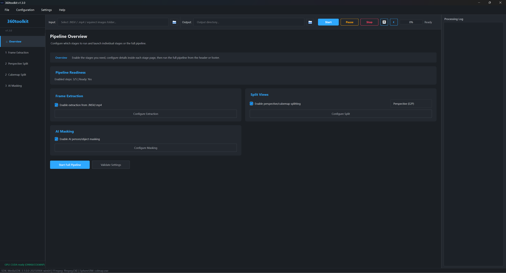
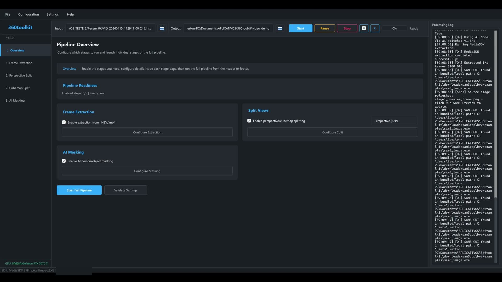

# 360toolkit



360toolkit is an application for photogrammetry preprocessing from 360 capture. It extracts stitched equirectangular frames, converts them into perspective or cubemap views, and generates masking assets for downstream tools such as RealityScan.

## Use It Two Ways

- Open-source repository: develop and run the pipeline from Python in this repository.
- Commercial Windows bundle: distributed separately as a paid binary release.

Download the binary: https://evertonbraz.gumroad.com/l/360toolkit

## Demo Video

[](resources/media/360toolkit_video_demo.mp4)

- Watch the local demo video: [resources/media/360toolkit_video_demo.mp4](resources/media/360toolkit_video_demo.mp4)
- The demo shows the extract -> split -> mask workflow in the current desktop application

## Current Pipeline

`Extract Frames` -> `Split Views` -> `Mask Images`

### Stage 1: Extract Frames

- Input: `.insv` and `.mp4`
- Output folder: `extracted_frames/`
- Primary method: Insta360 MediaSDK stitching
- Includes INSV trailer/camtype handling for Antigravity A1 sources, including A1-style calibration recovery paths in SDK extraction
- FFmpeg stitched mode is only for pre-stitched `.mp4` input
- Raw `.insv` stitched export should use SDK stitching; FFmpeg raw modes are for dual-lens or lens-specific fisheye export only
- Configurable FPS, start/end range, resolution, and output format
- Current default FPS is `2.0`

#### SDK Media Processing Controls (Stage 1)

Stage 1 exposes MediaSDK-backed processing controls that are applied during extraction, including:

- Stabilization: `FlowState` and `Direction Lock`
- Color processing: `Color Plus`
- Tone/color parameters: `Exposure`, `Highlights`, `Shadow`, `Contrast`, `Brightness`, `Black Point`, `Saturation`, `Vibrance`, `Temp`, `Tint`, `Definition`

These controls are available in the Extraction UI panel and are persisted into extraction configuration.

### Stage 2: Split Views

- Input: auto-discovered from `extracted_frames/` or supplied explicitly with the Stage 2 input folder
- Output folder: `perspective_views/`
- Transform modes:
  - Perspective split (E2P)
  - Cubemap 6-face
  - Cubemap 8-tile
- Current default transform is `perspective`
- Stage 2 supports:
  - Preserve-source or sequential frame numbering
  - Flat or by-camera folder layout
  - Split-only runs from an existing equirectangular folder
- Current defaults:
  - Frame numbering: `preserve_source`
  - Folder layout: `flat`

### Stage 3: Mask Images

- Current GUI workflow uses `SAM3.cpp` person masking
- Configure `segment_persons.exe`, a SAM3 model such as `sam3-q4_0.ggml`, and optionally `sam3_image.exe` in `Settings > Paths & Detection`
- The Stage 3 panel now exposes a `Video mode` checkbox for SAM3 sequence tracking on extracted frame folders; disable it to force normal per-frame masking
- Prompt-driven SAM3 masking is supported through selectable prompt categories plus free-form custom prompt text (comma-separated), enabling text-prompted masking targets
- The packaged Windows build now bundles the SAM3.cpp runtime in `_internal/sam3cpp` when `downloads/sam3cpp` is present at build time, including `segment_persons_track.exe` and the required CUDA BLAS DLLs for the shipping CUDA build when that backend is packaged
- Stage 3 supports:
  - Auto source selection between perspective views and extracted equirectangular frames
  - Selectable sequence mode for extracted frame sets (video-like tracking path when `segment_persons_track.exe` is available)
  - Mask-only runs from an explicit Stage 3 input folder
  - Circular fisheye masking (per-lens circular keep mask) for fisheye workflows
  - Preview generation through the SAM3 preview widget
  - Alpha-export and alpha-only modes
  - Custom prompt text and refinement controls

The current CUDA shipping tracker build includes the native flash-attention fix required for SAM3 video mode on the packaged Windows app, and the packaged EXE was validated with CUDA sequence tracking after rebuild.
- Output folders:
  - `masks_perspective/`
  - `masks_equirect/`
  - `alpha_cutouts/` when alpha-only output is used

## PNG vs JPEG Behavior

The pipeline order changes based on the Stage 2 image format.

- PNG split output: when Stage 2 and Stage 3 are both enabled, masking runs first on `extracted_frames/`, writes `alpha_cutouts/`, and Stage 2 splits those alpha images afterward.
- JPEG output: Stage 2 runs first, then Stage 3 masks the generated split images.

That branch exists so PNG workflows can preserve transparency through the split stage.

In practical terms, this pre-split masking path lets the pipeline reuse masks from the equirectangular domain before perspective/cubemap expansion. Example: mask `100` source frames first, then split once, instead of running masking on `~800` derived split images in an 8-view layout.

## Output Layout

Typical project output looks like this:

```text
output/
├── extracted_frames/
├── perspective_views/
├── masks_perspective/
├── masks_equirect/
└── alpha_cutouts/
```

Not every folder is created on every run. The exact set depends on which stages are enabled and whether Stage 3 is targeting equirectangular frames, split views, or alpha-only export.

## Source Setup

### Requirements

- Windows 10/11
- Python 3.10+
- FFmpeg available on `PATH` for FFmpeg extraction modes
- Insta360 MediaSDK for SDK stitching
- External SAM3.cpp binaries and model files for Stage 3

### Install

```powershell
git clone https://github.com/Everton-Braz/360toolkit.git
cd 360toolkit

python -m venv .venv
.\.venv\Scripts\Activate.ps1
pip install -r requirements.txt
python run_app.py
```

## CLI Mode

The application also exposes a CLI entry through `src/main.py`.

```powershell
python -m src.main --cli --input <input.insv> --output <output-folder> --stage all
```

Useful options include:

- `--stage all|extract|split|mask`
- `--stage2-input-dir <folder>`
- `--stage3-input-dir <folder>`
- `--stage2-numbering preserve_source|sequential`
- `--stage2-layout flat|by_camera`

## Repository Layout

```text
360toolkit/
├── src/
│   ├── extraction/
│   ├── masking/
│   ├── pipeline/
│   ├── transforms/
│   ├── ui/
│   └── config/
├── resources/
├── docs/
├── specs/
├── tests/
├── run_app.py
├── requirements.txt
└── README.md
```

## Notes

- The repo is source-focused. The paid Windows binary is distributed outside this repository.

